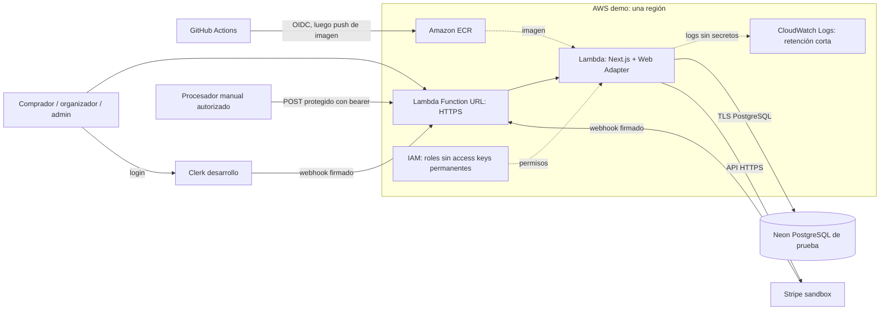
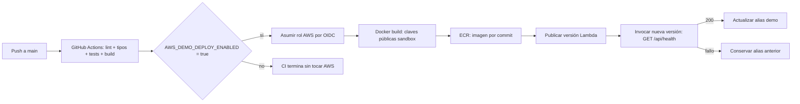

# Ticketera demo en AWS: arquitectura y CI/CD

Fecha: 2026-10-14. **Demo académica, credenciales de prueba y presupuesto total disponible de $100 en créditos. No es un diseño para venta real.**

**Actualización 2026-10-16:** el proyecto usa la nueva experiencia AWS Projects y su región permitida es Ohio (`us-east-2`), no Virginia. ECR, rol runtime, logs y presupuesto de seguimiento ya están creados. El acceso OIDC está restringido por políticas administradas; no activar características avanzadas ni cambiar el plan para resolverlo. El estado de instalación y los bloqueos están en [aws-deployment-progress.md](aws-deployment-progress.md); las referencias posteriores a bootstrap pendiente describen el diseño original.

[Artifact con iconos oficiales](artifacts/aws-ticketera.html) · [Funcionamiento SVG](artifacts/aws-runtime.svg) · [CI/CD SVG](artifacts/aws-delivery.svg).

## 1. Alcance acordado

- El usuario confirmó que no habrá salida comercial a producción.
- Stripe y Clerk usan sus entornos de desarrollo/sandbox. AWS sí ejecuta recursos reales que consumen el crédito; no existe una clave `sk_test` para volver gratuito todo AWS.
- **No se enviarán confirmaciones ni entradas por correo.** No configurar Resend/SES. `NOTIFICATIONS_ENABLED` requiere exactamente `true` para permitir envíos y queda deshabilitado por defecto; el arranque del contenedor demo fuerza `false`.
- Sin dominio obligatorio: usar la URL HTTPS que proporciona Lambda. Route 53 es opcional para una etapa futura.
- Sin WAF, ALB, NAT Gateway, RDS, Fargate ni servicios de construcción/despliegue de AWS en esta etapa.
- GitHub Actions valida y prepara despliegues de la rama `main`, usando OIDC; no access keys permanentes.
- Conservar PostgreSQL de demostración en Neon, que ya usa el proyecto, para evitar migración y costo fijo de RDS.

Clerk gestiona sus propios flujos de identidad; para esta etapa usar cuenta existente/inicio con Google y no probar invitaciones o recuperación por correo. El interruptor anterior controla las confirmaciones de compra de Ticketera, no los servicios externos de identidad.

## 2. Servicios y necesidad

| Servicio | Estado | Uso |
|---|---|---|
| AWS Lambda | Núcleo | Contenedor Next.js con Lambda Web Adapter; ejecución bajo demanda |
| Lambda Function URL | Núcleo, capacidad de Lambda | URL pública HTTPS generada, sin ALB/API Gateway/dominio propio |
| Amazon ECR | Núcleo | Guardar imagen del contenedor en la misma región que Lambda |
| Amazon CloudWatch Logs | Núcleo | Errores y logs; retención inicial propuesta de 3 días |
| AWS IAM / OIDC | Núcleo | Rol de ejecución Lambda y rol GitHub Actions acotado al repositorio/main |
| GitHub Actions | Núcleo externo a AWS | CI y CD; reemplaza CodeBuild y CodePipeline |
| Neon PostgreSQL | Existente, fuera de AWS | Tablas y colas de la demo; conexión cifrada y datos de prueba |
| Clerk desarrollo | Existente, externo | Sesiones y roles actuales; no se migra a Cognito |
| Stripe sandbox | Existente, externo | Compras, webhooks y devoluciones solo de prueba |
| AWS Budgets / Cost Explorer | Control de gasto | Revisar crédito/consumo y definir avisos; no son un corte automático de facturación |
| EventBridge Scheduler + ejecutor | Opcional, apagado inicialmente | Automatizar un lote mientras se presenta la demo; el procesador manual ya existe |
| Amazon S3 | Opcional | Solo cuando se implemente subida de archivos; por ahora funcionan portadas por URL HTTPS |
| Amazon Route 53 | Opcional, no crear ahora | DNS cuando exista dominio; no es necesario para la Function URL |

**No crear recursos vacíos “para después”.** La región se configura una sola vez en `AWS_REGION`, después de revisar la cuenta y disponibilidad del plan. No mantener copias en varias regiones. São Paulo no queda impuesta: comparar costo/latencia con la región que ya eligió el usuario.

## 3. Diagrama de funcionamiento

No se dibuja Resend como servicio activo ni un flujo de envío de correos. Los QR y las compras permanecen en la aplicación. AWS Lambda Web Adapter permite ejecutar el servidor Next.js actual en un contenedor; **no se han probado todavía los flujos completos desplegados en Lambda**. Se requiere comprobar Clerk, firmas de webhooks, headers de origen, pago integrado, imágenes, tiempos y conexiones SQL antes de usar la demo remota.

Fuentes: [Lambda Web Adapter oficial](https://github.com/aws/aws-lambda-web-adapter), [Function URLs](https://docs.aws.amazon.com/lambda/latest/dg/urls-configuration.html).

## 4. HTTPS, autenticación y límites

- Crear Function URL sobre el alias **`demo`**, con autenticación de infraestructura `NONE`, porque compradores y webhooks deben llegar desde un navegador/proveedor sin firmar peticiones AWS. Aplicar la política de recursos correspondiente que permite invocación a través de esa URL, según la documentación vigente. No publicar una ruta de Lambda Invoke abierta innecesariamente.
- `NONE` no elimina la seguridad de Ticketera: Clerk, roles/propietario, tokens privados de pedidos, firmas de Stripe/Clerk y bearer de jobs siguen verificándose en servidor.
- Usar la URL HTTPS completa de ese alias en `APP_URL` y en configuración de redirect/webhooks de prueba. Evitar CORS abierto si la app y API usan el mismo origen.
- Mantener sandbox en runtime: el script de arranque rechaza claves privadas/públicas que no comiencen con `sk_test_`/`pk_test_`, sin mostrar sus valores. No valida por sí solo que un usuario haya conectado el sandbox correcto; eso se comprueba al configurar los proveedores.
- No asignar VPC a esta Lambda: Neon y los proveedores usan HTTPS/TLS públicos. Así no hacen falta NAT Gateway, subredes ni RDS privados para la demo.
- Inicio en frío y suspensión son límites aceptados de esta demo. No habilitar Provisioned Concurrency. Empezar con 1 GiB de memoria y timeout de web propuesto de 300 segundos; medir y reducir, sin interpretar esos valores como una estimación de capacidad.
- Limitar concurrencia cuando la cuota de la cuenta lo permita, por ejemplo a 2 para una demostración pequeña. Algunas cuentas nuevas no permiten reservar concurrencia por sus cuotas; comprobarlo antes, sin solicitar aumentos o cambiar de plan automáticamente. Pool actual: hasta 5 conexiones por entorno Lambda, por lo que la concurrencia multiplica las conexiones a Neon.
- La Function URL se factura junto con sus invocaciones Lambda; no presupone consumo cero. Mantener disponible un mecanismo de pausa y no difundir la URL fuera del grupo de pruebas.

Route 53 **no da por sí solo un dominio HTTPS propio a una Function URL**. Si después se compra dominio, habrá que diseñar además el enrutamiento/TLS compatible, por ejemplo con CloudFront; no crear esa infraestructura ahora.

## 5. Contenedor preparado en el repositorio

- `infra/aws-demo/Dockerfile`: Node 24, instalación desde lockfile, Next standalone y versión fijada `1.1.0` de Lambda Web Adapter oficial.
- `next.config.ts`: activa standalone únicamente con `TICKETERA_BUILD_TARGET=lambda`. El modo de desarrollo habitual permanece igual.
- `.dockerignore`: excluye `.env*`, credenciales, Git, capturas y dependencias locales del contexto de build.
- `infra/aws-demo/start.mjs`: exige configuración sandbox/QR/URLs, fuerza correo deshabilitado y arranca `server.js`. El cache de imágenes apunta a `/tmp`, el directorio escribible de Lambda.
- El servidor escucha en 8080; Lambda Web Adapter convierte eventos HTTP y usa modo buffered. Construir una sola arquitectura `linux/amd64`, sin attestations multi-arch incompatibles con Lambda.
- `/api/health`: respuesta estática sin secretos ni consultas SQL para un smoke test de arranque. **No valida una compra ni la conexión a la base**.

No hay evidencia de un build/arranque de esta nueva imagen en Docker o Lambda todavía. La preparación anterior para GCP/Fargate es histórica y no debe mezclarse con esta imagen demo.

## 6. CI/CD de GitHub Actions

Se amplía `.github/workflows/ci.yml`, sin crear un segundo pipeline paralelo:

- PR: solo validaciones, sin rol AWS. `push` a `main`: validaciones y después CD, **si está habilitado**. `master` conserva CI pero no despliega.
- No insertar expresiones de entrada de PR dentro de comandos privilegiados. OIDC trust debe restringirse a `repo:OWNER/REPO:ref:refs/heads/main` y audiencia `sts.amazonaws.com`.
- La etapa CD recibe `id-token: write` y lectura del repositorio; no necesita permisos para escribir código ni secretos privados de Stripe/Clerk en GitHub.
- Construye/publica en ECR, actualiza código y publica versión Lambda, espera su actualización, hace smoke test sobre la nueva versión y solo entonces cambia el alias `demo`. La URL pública sigue apuntando al alias estable.
- No cancelar una ejecución de despliegue en marcha por un push nuevo. Concurrencia del workflow serializa `main`; los PR sí pueden cancelar sus comprobaciones anteriores.
- Fallo del smoke test deja la URL en la versión anterior. El test es de arranque, no E2E. Una versión con arranque correcto pero fallo funcional requiere volver a apuntar el alias a la versión previa.
- No ejecutar seed ni migraciones automáticamente con cada push. Cambios de esquema se revisan y aplican aparte sobre la base de demostración.

### Variables del repositorio necesarias

En GitHub → Settings → Secrets and variables → Actions → Variables:

| Variable | Contenido |
|---|---|
| `AWS_DEMO_DEPLOY_ENABLED` | `true` solo después del bootstrap y validación de costos; ausente/false no despliega |
| `AWS_REGION` | Región única escogida por el usuario |
| `AWS_ROLE_ARN` | ARN del rol IAM que GitHub asume por OIDC |
| `AWS_ECR_REPOSITORY` | Nombre del repositorio ECR existente |
| `AWS_LAMBDA_FUNCTION_NAME` | Nombre de la función demo existente |
| `NEXT_PUBLIC_CLERK_PUBLISHABLE_KEY` | Clave pública `pk_test_...` de Clerk |
| `NEXT_PUBLIC_STRIPE_PUBLISHABLE_KEY` | Clave pública `pk_test_...` de Stripe |

### Bootstrap único, todavía pendiente

1. Verificar plan/crédito/fecha de vencimiento y elegir una región. Crear un ECR con tags inmutables. Cada tag incluye commit, ID de ejecución e intento de GitHub, para permitir reintentar un despliegue sin sobrescribir imágenes. Limpiar manualmente imágenes no referenciadas, conservando la activa y la anterior de rollback; no aplicar un lifecycle ciego que borre una imagen todavía usada por un alias/versión Lambda.
2. Crear IAM OIDC para GitHub y un rol limitado al repositorio ECR y función demo. Permitir ECR push y lectura necesarios; `ecr:GetAuthorizationToken` requiere alcance `*`. Para la función: leer configuración/URL/alias, actualizar código, publicar versión, invocar la versión de smoke y actualizar el alias. Acotar los ARN de función y versiones. No necesita AdministratorAccess, acceso a secretos ni `iam:PassRole` para actualizar una función ya creada.
3. Crear rol runtime Lambda con logs básicos. No dar permisos de despliegue a la aplicación.
4. Construir/subir la imagen inicial con las claves públicas de sandbox. Crear la función `PackageType=Image`, arquitectura x86_64 y variables sandbox; publicar su primera versión, crear alias `demo` y su Function URL. Esa creación inicial no la hace el workflow de actualización.
5. Configurar `APP_URL` con la Function URL del alias y las variables que aparecen debajo; publicar versión actualizada y actualizar alias si el cambio de URL fue posterior. Después configurar redirects y webhooks sandbox de los proveedores.
6. Crear grupo de CloudWatch con retención de 3 días; configurar avisos de presupuesto y revisión de consumo. Probar la URL, los proveedores y el flujo local/remoto sin activar correos.
7. Configurar las variables GitHub y recién entonces habilitar CD. Un push a `main` podrá actualizar la demo; no se ha hecho push ni activado la conexión con la cuenta AWS en esta entrega.

Variables privadas se configuran en el entorno cifrado de Lambda, **no** en Docker/build: `DATABASE_URL`, `CLERK_SECRET_KEY`, `CLERK_WEBHOOK_SIGNING_SECRET`, `STRIPE_SECRET_KEY`, `STRIPE_WEBHOOK_SECRET`, `PAYMENT_JOBS_SECRET` y `QR_SIGNING_SECRET`. Añadir claves públicas de sandbox también al entorno runtime, coherentes con el build. `APP_URL` es la URL generada. Mantener `NOTIFICATIONS_ENABLED=false` y no añadir claves Resend.

Lambda limita el tamaño conjunto de variables de entorno; verificar el límite de 4 KiB al configurar. No imprimir configuración completa en CI/logs. Si más adelante no alcanza, evaluar Parameter Store/Secrets Manager como cambio explícito, sin añadir ese costo antes de necesitarlo. Preservar `QR_SIGNING_SECRET`: cambiarlo puede invalidar credenciales y documentos cifrados.

Fuentes: [OIDC GitHub → AWS](https://docs.github.com/en/actions/how-tos/secure-your-work/security-harden-deployments/oidc-in-aws), [acción oficial de credenciales](https://github.com/aws-actions/configure-aws-credentials).

## 7. Procesamiento de compras: manual al inicio

El webhook de Stripe persiste un evento, pero no procesa por sí solo toda la compra. Para completar pago → entradas es necesario ejecutar el procesador contra la Function URL, con autorización explícita y credenciales sandbox.

Se reutiliza `npm run payments:process` para un lote puntual; `APP_URL` debe apuntar a la demo remota y el `PAYMENT_JOBS_SECRET` debe coincidir. El procesador puede cerrar reservas o ejecutar devoluciones de prueba pendientes. **No se ejecutó durante esta entrega.**

EventBridge Scheduler y un ejecutor Lambda pequeño son una mejora opcional, inicialmente deshabilitada. Si se activa, usar `rate(1 minute)` solo durante las sesiones de prueba y apagar al terminar. Implementar antes el control de lotes solapados y comprobar exit status/reintentos; no crear un temporizador permanente en el proceso Next.js. El worker automático no se considera instalado ni funcionando por aparecer en el diagrama.

No usar Resend, SES ni una cola nueva para emails. El outbox existente permanece intacto; sus filas no se envían ni se borran por desactivar correo.

## 8. Protección de los $100 de crédito

Los $100 son **crédito disponible**, no una garantía de que todos los servicios sean gratuitos. La página oficial de AWS distingue Free plan y Paid plan; no se ha comprobado cuál tiene esta cuenta ni su fecha de vencimiento. Verificar ambos en Billing antes de desplegar y no cambiar a plan de pago para sortear un bloqueo de servicio sin decidirlo expresamente.

Controles concretos:

- Nada de RDS, ALB, NAT, Fargate encendido permanentemente, CodeBuild/CodePipeline, WAF, dominio ni Provisioned Concurrency.
- Revisar créditos/consumo al terminar cada sesión. Propuesta de avisos: $5, $10 y $20 acumulados; son umbrales de revisión, **no precios estimados de la demo**. Configurar mediante la cuenta de facturación según disponibilidad/costo de presupuestos; un aviso no corta cargos.
- CloudWatch con retención corta y logs sin payloads privados. ECR sin acumular una imagen distinta por cada prueba indefinidamente.
- Procesamiento manual al inicio; schedules apagados fuera de la presentación. Al terminar, desactivar acceso/automatismos no necesarios y limpiar recursos de ensayo conforme a lo que se deba conservar.
- No prometer costo mensual cero: invocaciones, duración/memoria, almacenamiento de imágenes, logs y transferencia pueden consumir crédito. La URL pública también puede recibir tráfico ajeno; limitar cuota/concurrencia cuando sea posible y pausar la demo si hay abuso.
- GitHub Actions tiene sus propios límites de minutos/almacenamiento; no se descuentan del crédito AWS. Usar runners GitHub hospedados estándar y evitar reconstrucciones innecesarias.

[Condiciones actuales de Free Tier y créditos](https://aws.amazon.com/free/). No se activaron servicios, gastos, presupuestos ni acceso a la cuenta del usuario con estos archivos.

## 9. Iconos y estado verificable

Los diagramas usan **iconos oficiales de arquitectura AWS** para los servicios mostrados; se conservan sin modificar en `artifacts/icons/` y se incluyen dentro de los SVG para que puedan compartirse. [Procedencia y permiso de uso](artifacts/icons/SOURCE.md). Las marcas pertenecen a AWS; el diagrama no implica una certificación o aprobación de AWS.

Estado: arquitectura ajustada y workflow/configuración preparados localmente. Aún faltan bootstrap, variables del repositorio, imagen Docker verificada en Linux, pruebas E2E de Next.js/Clerk/Stripe sobre Lambda y activación del deploy. El smoke check no sustituye esas pruebas. S3, Route 53 y automatización periódica están marcados como opcionales, no como recursos ya creados.

## 10. Validación de esta entrega

- 28 pruebas focalizadas pasan: arranque sandbox, correo deshabilitado y regresiones de gestión de eventos.
- TypeScript, lint y `npm run build` habitual pasan. Esa compilación no valida aún la imagen standalone/Linux de Lambda.
- YAML del workflow y sintaxis del visor comprobados; SVG válidos y revisión visual de iconos/conexiones. Pestañas y zoom comprobados en navegador local.
- Revisión independiente corrigió el reintento de despliegue con tags ECR inmutables mediante tags únicos por commit/ejecución/intento.
- Un intento de suite completa se interrumpió tras un timeout de una prueba existente; esa prueba pasa al ejecutar su archivo de forma aislada. No se declara una nueva ejecución completa exitosa de toda la suite.
- Docker no pudo arrancar el motor Linux local. No se ejecutaron Docker build, despliegue, migraciones remotas, procesador financiero ni envíos externos.
