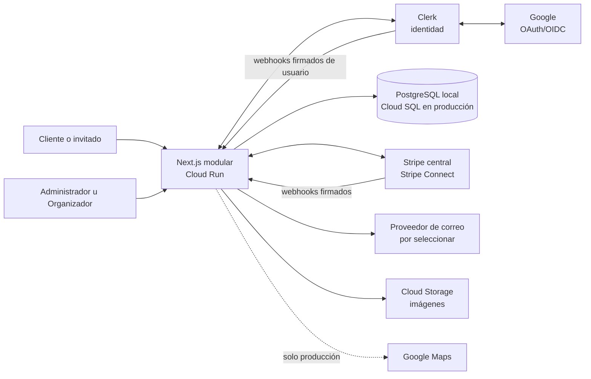
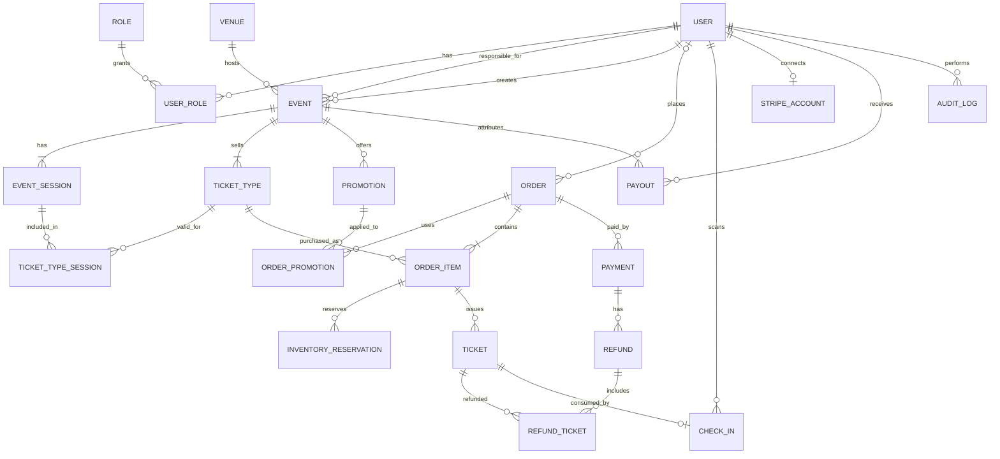

# System Design — Arquitectura y MER de Ticketera

> **Estado:** PENDIENTE DE APROBACIÓN DEL DOCUMENTO  
> **Autorización de implementación parcial:** el usuario aprobó usar este MER y elegir ORM con «ok procede» para crear tablas, relaciones, índices y recepción de webhooks Stripe. El resto de decisiones pendientes conserva su estado.
> **Tipo de trabajo:** diseño de sistema y modelo de datos; no implementar en esta etapa.  
> **Propósito:** dejar una fuente de verdad para que una sesión futura pueda continuar el diseño técnico y, después de aprobar esta especificación, preparar el plan de implementación.

## 1. Objetivo

Definir la arquitectura inicial de la plataforma de venta de entradas y su Modelo Entidad-Relación (MER), usando las pantallas actuales del repositorio y las decisiones confirmadas por el usuario. El sistema debe cubrir catálogo y detalle de eventos, eventos de varios días, compra como cliente autenticado o invitado, inventario, pagos, entradas digitales, acceso con QR, reembolsos, panel de organizador y liquidaciones.

Este documento trata el **System Design** de la aplicación. No es una especificación de identidad visual o Design System de componentes.

## 2. Contexto del proyecto y de la UI

El repositorio usa Next.js App Router, React, TypeScript y organización de código por módulos de dominio. La documentación del proyecto establece `docs/SETUP.md` como fuente de verdad para estructura y convenciones. A la fecha de este documento no hay integración o dependencias de Clerk, Stripe, PostgreSQL, ORM o herramienta de migraciones declaradas en `package.json`.

La UI presente en el repositorio es un prototipo sin persistencia ni integraciones reales:

- Inicio/catálogo: búsqueda y filtros de eventos, categorías, ciudades, meses y favoritos locales.
- Detalle y compra (`src/modules/events/components/EventPurchaseExperience.tsx`): zonas referenciales, precios de demostración, cantidad, formulario de checkout, nombre y correo. El pago no está conectado.
- Acceso (`src/app/ingresar/page.tsx`): prototipo de ingreso y registro con correo/contraseña y Google.
- Mis entradas (`src/app/mis-entradas/page.tsx`): entradas y QR ilustrativos sin validez.
- Portal del organizador (`src/app/organizador/page.tsx`): métricas ficticias y lista de eventos de demostración.
- Crear evento (`src/app/organizador/eventos/nuevo/page.tsx`): borrador local con título, categoría, ciudad, fecha, hora, recinto, descripción, imagen y tipos de entrada con precio/cantidad.

La UI de compra actual muestra zonas Platinum, VIP, Tribuna y General, y un máximo de seis entradas por operación. Son datos y límites de demostración; el límite de compra, las zonas y los cargos de servicio no se consideran reglas de negocio confirmadas. El mapa del recinto es referencial.

El listado actual procede de datos estáticos de eventos externos. No debe migrarse como inventario propio ni asumirse que sus precios/disponibilidad son reales.

El artifact de Claude compartido por el usuario no estuvo accesible desde las herramientas de esta sesión. El usuario autorizó tomar como referencia la UI del repositorio y compartir capturas de pantallas que falten. Al revisar el repositorio aparecieron las rutas nuevas descritas arriba; este documento las incluye.

## 3. Decisiones confirmadas

| Tema | Decisión |
| --- | --- |
| Alcance | Arquitectura de la aplicación y MER de la base de datos, derivados de la UI y reglas de negocio acordadas. |
| Arquitectura inicial | Monolito modular en Next.js; mantener límites por dominio para poder evolucionar más adelante. |
| Desarrollo | PostgreSQL accesible localmente (`localhost`). |
| Producción | Google Cloud Platform; Cloud Run propuesto para Next.js y Cloud SQL for PostgreSQL para datos. |
| País, moneda y hora | Perú; PEN; zona horaria `America/Lima`. |
| Autenticación | Clerk con correo/contraseña e inicio de sesión con Google (OAuth/OIDC). Google autentica la identidad; Clerk gestiona las cuentas y sesiones; PostgreSQL conserva el perfil y los roles del negocio. |
| Roles | Super admin, Administrador, Organizador de eventos y Cliente. Son roles globales. El Super admin es el único que asigna o retira los roles privilegiados de Administrador y Organizador. |
| Responsable de ingresos | Cada evento tiene un Organizador responsable para atribuir ventas y liquidaciones. Esa relación financiera no limita el alcance global del rol Organizador. |
| Eventos | Presenciales por ahora; un evento puede incluir varias fechas/sesiones. |
| Sedes/mapas | Google Maps se integrará en producción. La ubicación del evento se guarda como datos del negocio, no solo como texto. |
| Entradas | Cada evento ofrece varios tipos de entrada, con precio, cupo y periodo de venta propios. Puede haber entradas válidas para una fecha y pases para todas las fechas. |
| Ofertas | Se necesitan descuentos automáticos y códigos promocionales. |
| Compras | Se permiten compras autenticadas y como invitado. El correo es obligatorio. Una compra puede incluir muchas entradas; los datos de cada asistente son opcionales. |
| Vinculación de invitado | Tras verificar en Clerk el mismo correo de la compra, se vinculan automáticamente las compras de invitado a la cuenta. |
| Reserva de cupo | Se reserva inventario durante 15 minutos al iniciar checkout; si el pago no se completa dentro de ese plazo, se libera el cupo. |
| Pago | Stripe cobra inicialmente en una cuenta central de la plataforma. El backend confirma pagos mediante webhooks. |
| Liquidaciones | Se automatizan con Stripe Connect. Cada Organizador completa el onboarding/verificación. El Administrador decide cuándo iniciar la liquidación mediante una configuración. |
| Entrada digital | Se emite un ticket individual y QR único por cada unidad comprada. Se muestra en la cuenta y se envía al correo de compra. |
| Validación | Administradores y Organizadores pueden escanear y validar QR. Interpretación acordada: una entrada se valida una sola vez para el evento completo, aunque dure varios días. |
| Reembolsos | Se permiten reembolsos de entradas individuales hasta 48 horas antes del evento. Si se cancela el evento, se reembolsa a todos los compradores y se invalidan las entradas. |
| Pago tardío | Si Stripe confirma que el cobro se completó después del vencimiento de la reserva, se reembolsa automáticamente y no se emite ticket. |
| Imágenes | Cloud Storage es el almacenamiento propuesto para imágenes cargadas por Organizadores. |
| Seguridad de datos | Clerk/Stripe manejan identidad y medios de pago; la aplicación no almacena datos de tarjeta. Los QR no contienen PII. |

## 4. Alcance

### Incluido en esta arquitectura

- Catálogo, detalle, sedes y sesiones/fechas de eventos.
- Administración y publicación de eventos, con un Organizador responsable por evento.
- Tipos de entrada, cupos, ventanas de venta, pases multi-sesión y ofertas.
- Órdenes autenticadas o de invitado, reservas temporales de inventario y pago por Stripe.
- Emisión, visualización, envío por correo y validación de tickets/QR.
- Reembolsos parciales y por cancelación de evento.
- Cuenta Clerk, sincronización del perfil de aplicación, roles globales y autorización.
- Stripe Connect y liquidaciones decididas por el Administrador.
- Configuración local y de producción, manejo de secretos, almacenamiento de imágenes, registros y respaldo de base de datos.

### Fuera de alcance inicial

- Microservicios, Kubernetes/GKE y separación del frontend de una API independiente.
- Eventos virtuales o híbridos.
- Reventa, transferencias de tickets entre usuarios, listas de espera o asientos numerados con asignación de asiento individual.
- Una política de comisiones/cargos de servicio que no haya sido aprobada.
- Proveedor de correo y región concreta de Google Cloud, hasta su decisión.
- Implementación de código, migraciones ejecutables, creación de recursos en Google Cloud o configuración de cuentas Clerk/Stripe.

## 5. Arquitectura propuesta

### 5.1 Vista de contexto

### 5.2 Monolito modular

Next.js App Router sirve páginas, rutas servidoras y operaciones de negocio. Las rutas de `src/app/` se mantienen delgadas; los módulos de dominio poseen sus servicios y reglas de negocio siguiendo `docs/SETUP.md`.

Dominios propuestos:

1. `identity-access`: acceso con Google o correo/contraseña mediante Clerk, sincronización del perfil local, roles y autorización. No implementa un servidor OAuth propio.
2. `events`: eventos, organizador responsable, sedes y sesiones.
3. `ticketing`: tipos de entrada, validez por sesión, cupos y pases.
4. `promotions`: ofertas automáticas y códigos promocionales.
5. `checkout`: órdenes, líneas, precios congelados y reservas temporales.
6. `payments`: operaciones Stripe, webhooks, reembolsos y conciliación.
7. `tickets`: emisión, consulta, QR y check-in.
8. `settlements`: cuentas Connect y liquidaciones iniciadas por Administrador.
9. `notifications`: confirmación y envío de entradas por correo.

Una única base PostgreSQL da transacciones consistentes para los flujos que compiten por el mismo cupo. No se separan servicios por dominio en la primera versión.

### 5.3 Ambientes

| Ambiente | Aplicación | Base de datos | Integraciones |
| --- | --- | --- | --- |
| Local | Next.js en desarrollo | PostgreSQL en `localhost` | Credenciales de prueba separadas; Stripe en modo de prueba y Clerk de desarrollo al implementar. Google Maps puede quedar apagado localmente. |
| Producción | Cloud Run | Cloud SQL for PostgreSQL | Secret Manager para secretos; Stripe Connect; correo transaccional; Google Maps; Cloud Storage. |

No copiar datos personales de producción a local. La región de GCP y las políticas de retención se deciden antes del despliegue productivo.

### 5.4 Identidad con Google

Google es el proveedor de identidad y Clerk administra la conexión social, el retorno OAuth y la sesión de la aplicación. Next.js valida la sesión Clerk en servidor antes de resolver el perfil local y autorizar operaciones. El navegador no puede asignar roles ni acreditar por sí mismo que un correo está verificado.

Habilitar la conexión Google en Clerk de desarrollo y configurar credenciales OAuth propias para producción, con los dominios y URI de retorno que indique Clerk. Mantener credenciales separadas entre ambientes y el secreto de Google en la configuración segura del proveedor, nunca en el frontend. Solicitar solo identidad básica (`openid`, `email`, `profile`); no se requiere acceso a Drive, Calendar ni otros servicios de Google. Referencia: [conexión Google en Clerk](https://clerk.com/docs/guides/configure/auth-strategies/social-connections/google).

La aplicación no guarda contraseñas, tokens OAuth de Google ni sesiones en PostgreSQL. Las identidades externas permanecen en Clerk; no hace falta agregar una tabla local de cuentas Google para este alcance. Los métodos de acceso pueden coexistir sobre un mismo usuario Clerk y un único perfil de negocio.

## 6. Flujos críticos

### 6.1 Crear y publicar evento

1. Un Administrador u Organizador crea un borrador con datos del evento, sede, fechas, imagen, tipos de entrada, cupos, fechas de venta y ofertas.
2. El evento queda atribuido a un Organizador responsable para su rendimiento y liquidaciones.
3. El responsable debe tener Stripe Connect verificado antes de recibir liquidaciones. La condición exacta para publicar se deja como decisión pendiente.
4. Al publicar, el evento aparece en catálogo; el precio/disponibilidad se calcula desde el inventario propio.

Los estados de evento (`draft`, `published`, `cancelled`, `completed`) son una propuesta para validar al convertir este diseño en plan de implementación.

### 6.2 Checkout y emisión de tickets

1. El comprador selecciona una sesión o pase, tipo de entrada y cantidad; puede aplicar oferta automática y/o código promocional.
2. El servidor valida disponibilidad, reglas de venta, precio y descuentos. Una transacción bloquea/actualiza inventario de forma segura, crea la orden pendiente y una reserva con `expires_at = created_at + 15 minutes`.
3. El servidor inicia el pago Stripe con clave idempotente y sin exponer secretos al navegador.
4. Stripe notifica el resultado por webhook verificado. Cada `stripe_event_id` se procesa como máximo una vez.
5. Pago completado dentro del plazo: orden pagada, reserva convertida en venta, un ticket por unidad, token QR único y envío de confirmación.
6. Pago no completado: al expirar la reserva se libera el cupo. Si el pago se completó después de expirar, reembolso automático y sin emisión de tickets.
7. Si el comprador compró como invitado, el backend de la aplicación vincula la orden cuando un correo de la cuenta esté verificado en Clerk y coincida con el correo comprador; esto también aplica al acceso con Google. Clerk acredita la identidad, pero no modifica las órdenes de PostgreSQL.

La implementación debe evitar sobreventa bajo compras simultáneas. El cupo disponible se calcula descontando tickets emitidos y reservas activas no expiradas; la mutación final se protege dentro de una transacción PostgreSQL.

**Nota de compatibilidad con Stripe Checkout:** la API documenta `expires_at` de una Checkout Session entre 30 minutos y 24 horas desde su creación. Como la regla acordada reserva cupo por 15 minutos, no se debe configurar `expires_at` a 15 minutos. Si se elige Checkout hospedado, al llegar al minuto 15 un proceso servidor debe solicitar la expiración de la sesión si sigue abierta, consultar/reconciliar su estado y liberar el cupo solo después de confirmar que no fue pagada. Si ya se completó, el tiempo de finalización determina si se honra la reserva o se reembolsa según la regla acordada. Esto evita confundir la demora de un webhook con un pago tardío. La implementación debe manejar la carrera entre expiración y pago de forma idempotente. Fuentes oficiales: [crear Checkout Session](https://docs.stripe.com/api/checkout/sessions/create) y [expirar Checkout Session](https://docs.stripe.com/api/checkout/sessions/expire).

### 6.3 Reembolso y cancelación

- Permitir reembolso parcial por uno o más tickets hasta 48 horas antes del inicio del evento en hora `America/Lima`.
- Al reembolsar, marcar los tickets afectados como inválidos e impedir el check-in.
- Al cancelar un evento, crear reembolsos para todas las órdenes pagadas, anular tickets y registrar resultados de Stripe.
- Si un reembolso falla o queda pendiente, conservar el estado para reintento/conciliación; no marcarlo como completado hasta confirmación del proveedor.

### 6.4 Check-in

- El QR representa un token opaco aleatorio; no codifica nombre, correo, ID de usuario ni datos de pago.
- Administrador u Organizador autenticado escanea el QR; el servidor verifica estado pagado/válido y registra usuario, evento y hora.
- La restricción de unicidad rechaza escaneos repetidos para el evento. Para un evento de varios días, el diseño actual consume la entrada en el primer check-in del evento completo.

### 6.5 Liquidación

- Registrar la cuenta Connect verificada del Organizador responsable.
- El Administrador configura/inicia la liquidación; registrar importe, evento/periodo, cuenta destino, estado e identificador Stripe.
- No enviar dos veces una liquidación por reintento: claves idempotentes y conciliación contra Stripe.

### 6.6 Acceso con Google y sincronización del usuario

1. El usuario selecciona «Continuar con Google» en ingreso o registro. Clerk dirige la autenticación a Google y procesa el retorno; si se cancela o falla, no se habilitan operaciones autenticadas.
2. Una sesión Clerk válida identifica al usuario por `clerk_user_id`. El servidor obtiene de Clerk el perfil y el estado de verificación de sus correos.
3. `identity-access` crea o actualiza el perfil local mediante un upsert por `clerk_user_id`; una cuenta nueva recibe únicamente el rol `customer`. Repetir el acceso no duplica el usuario ni reemplaza sus roles existentes.
4. Si ya existe una cuenta de correo/contraseña, Clerk gestiona la vinculación con Google y sus verificaciones. La aplicación no fusiona usuarios locales por una coincidencia de correo. Referencia: [vinculación de cuentas OAuth](https://clerk.com/docs/guides/configure/auth-strategies/social-connections/account-linking).
5. Tras comprobar un correo verificado desde Clerk, el backend puede reclamar órdenes de invitado con ese correo normalizado y `user_id IS NULL`, en una transacción idempotente. No reasigna órdenes que ya pertenecen a otro usuario, no cambia el correo histórico del comprador y no concede roles por dominio de correo.
6. Webhooks firmados `user.created`, `user.updated` y `user.deleted` mantienen el perfil local actualizado. Como su entrega es eventualmente consistente, el primer acceso debe resolver el perfil sin depender de que el webhook haya llegado. Procesar duplicados y eventos fuera de orden sin sobrescribir datos más recientes. Referencia: [sincronización de usuarios con webhooks](https://clerk.com/docs/guides/development/webhooks/syncing).
7. Al eliminar la cuenta en Clerk, desactivar el acceso al perfil local y conservar las referencias necesarias de órdenes, tickets y auditoría conforme a la política de retención pendiente. El historial financiero no se elimina en cascada.

## 7. MER conceptual

Los nombres de tablas/columnas finales se escribirán en inglés, de acuerdo con las convenciones del proyecto. El siguiente diagrama es lógico; constraints e índices se definirán en el plan y el diseño físico.

### 7.1 Entidades y responsabilidades

| Entidad | Responsabilidad y datos clave |
| --- | --- |
| `user` | Perfil interno: `id` como PK, `clerk_user_id` único y obligatorio, `email` primario normalizado, `email_verified_at` nullable, `name`, `avatar_url` opcional, `status` (`active`/`inactive`), `identity_updated_at`, `created_at` y `updated_at`. No replica credenciales; Google y correo/contraseña usan este mismo perfil. |
| `role`, `user_role` | Catálogo de roles y asignaciones globales. `customer` es el rol inicial; Super admin administra roles privilegiados. |
| `venue` | Recinto presencial: nombre, dirección, ciudad, país, coordenadas y `google_place_id` opcional. |
| `event` | Nombre, descripción, categoría, estado, imagen, sede, responsable Organizador y creador/auditoría. |
| `event_session` | Fecha/sesión con inicio y fin `timestamptz`; representar en la UI usando `America/Lima`. Un evento tiene una o más sesiones. |
| `ticket_type` | Clase comercial de entrada, precio en PEN como importe monetario exacto, cupo, ventana de venta y evento. |
| `ticket_type_session` | Relación entre tipo y sesiones válidas. Una entrada diaria se vincula a una sesión; un pase multi-día se vincula a todas las sesiones incluidas. |
| `promotion` | Descuento automático o código promocional; tipo/regla, vigencia, límites y alcance a evento/tipos. La aplicación concreta queda en `order_promotion`. |
| `order` | Comprador; `user_id` nullable, correo y nombre comprador obligatorios, estado, moneda y totales congelados. Invitados no requieren cuenta Clerk. |
| `order_item` | Tipo de entrada, cantidad, precio unitario, descuentos y total congelados al ordenar. |
| `inventory_reservation` | Cantidad retenida por orden/línea, estado, creación y expiración de 15 minutos. |
| `payment` | Intento/transacción Stripe, IDs externos, importe, estado, moneda y timestamps. Una orden puede tener intentos idempotentes. |
| `ticket` | Una fila por unidad: orden/línea, código QR opaco (guardar hash/token no reversible), estado y datos opcionales de asistente. |
| `check_in` | Ticket consumido, evento, usuario que escanea y hora. Debe impedir un segundo uso del mismo ticket para el mismo evento. |
| `refund`, `refund_ticket` | Reembolso Stripe y sus tickets/importe asociados para soportar reembolsos parciales. |
| `stripe_account` | Cuenta Connect asociada al Organizador responsable, estado de onboarding/verificación y referencia externa. |
| `payout` | Liquidación a Organizador/evento/periodo, importe, estado y referencia Stripe. |
| `webhook_event` | `provider` (`clerk`/`stripe`), `external_event_id`, tipo, estado de procesamiento, intentos y timestamps; unicidad compuesta `(provider, external_event_id)` para evitar efectos duplicados de ambos proveedores. |
| `audit_log` | Actor, acción, entidad, ID, fecha y metadatos seguros para roles, eventos, reembolsos y liquidaciones. |

### 7.2 Reglas de integridad propuestas

- Guardar importes como entero en unidad menor (céntimos de PEN) o `numeric` exacto; no usar `float` para dinero. Fijar una sola estrategia en el plan técnico.
- Cupos, cantidades y cantidades de reservas son enteros positivos. Una actualización transaccional impide superar el cupo.
- Una orden conserva snapshots de precio/descuento para que cambios posteriores del catálogo no alteren compras históricas.
- Un ticket pertenece a una sola unidad de orden; token QR único y nunca reutilizado.
- `clerk_user_id`, ID de Stripe, ID de webhook y códigos de promoción deben tener unicidad adecuada.
- Roles de Administrador/Organizador no se guardan solo en metadatos modificables desde cliente; consultar y autorizar del lado servidor.
- Todas las FK del negocio referencian `user.id`; `clerk_user_id` es el enlace de identidad estable, no el correo ni un ID Google duplicado. No usar `auth_provider = google` como método exclusivo, porque una cuenta puede tener varios métodos de ingreso.
- `email_verified_at` refleja la verificación del correo primario actual; al cambiarlo se actualiza o se limpia según Clerk. Para reclamar compras consultar correos verificados vigentes desde Clerk; no confiar únicamente en una copia local potencialmente desactualizada.
- Normalizar correos de forma consistente sin quitar puntos ni sufijos `+`. Indexar el correo de comprador de `order` para buscar órdenes sin propietario; la actualización debe conservar `user_id IS NULL` como condición ante accesos concurrentes.

## 8. Seguridad, confiabilidad y operación

- Autorización en servidor en cada ruta/acción de negocio. No confiar en rol, precio, cantidad, descuento o estado enviado por el navegador.
- Webhooks Clerk/Stripe: verificar firma, persistir ID de evento, procesar de forma idempotente y hacer reintentos controlados.
- Secretos de producción en Google Secret Manager; variables locales fuera de control de versiones. No colocar secretos en componentes cliente.
- El pago con tarjeta se aloja/procesa en Stripe; la aplicación no recibe ni guarda PAN/CVV.
- Tokens QR opacos, con mínimo privilegio para operadores de check-in y sin PII en el contenido.
- Auditoría de cambios de rol, publicación/cancelación, reembolsos y liquidaciones. No registrar secretos, tokens de sesión ni datos de tarjeta.
- Cloud SQL con TLS/conectividad privada según configuración GCP, backups y recuperación a punto en el tiempo habilitados en producción.
- Reintentos de correo/webhooks/pagos no duplican tickets, reembolsos ni transferencias.
- Correo transaccional requerido para invitados y confirmaciones; proveedor por seleccionar.

## 9. Pendientes explícitos para la siguiente sesión

Resolver o documentar estas decisiones antes de implementar los flujos afectados:

1. Revisar esta especificación escrita y cambiar su estado a aprobada cuando el usuario la acepte.
2. Confirmar el artifact de Claude/capturas si contiene pantallas no reflejadas en el repositorio.
3. Elegir proveedor de correo transaccional.
4. Elegir región de Google Cloud/Cloud SQL y confirmar política de respaldo/retención adecuada.
5. Definir método para bootstrap del primer Super admin.
6. Definir granularidad de configuración de liquidaciones (por evento, periodo u otra regla) y comisiones de plataforma.
7. Confirmar si el límite de seis entradas por compra de la UI demo será una regla real.
8. Confirmar si la disponibilidad recuperada por un reembolso vuelve a ofrecerse mientras las ventas siguen abiertas.
9. Fijar reglas de estados, publicación y aprobación de eventos, y si la cuenta Connect verificada es requisito para publicar.
10. Elegir ORM/Query Builder y herramienta de migraciones compatible con PostgreSQL/Next.js antes de crear el esquema ejecutable.
11. Confirmar si el mapa de zonas referencial se reemplaza por un plano por evento/sede y si habrá asientos numerados.

Los puntos pendientes no invalidan el límite arquitectónico de monolito modular; son decisiones de producto/diseño físico que conviene cerrar antes de escribir migraciones y conectar proveedores.

## 10. Handoff para una sesión futura

Una IA que continúe debe:

1. Leer `CLAUDE.md`, `docs/SETUP.md` y esta especificación completa.
2. Pedir/confirmar cambios del usuario sobre este documento y sus pendientes; actualizarlo antes de implementar.
3. No asumir que las cifras, precios, QR o pagos de la UI demo son reales.
4. Una vez aprobada esta especificación, elaborar un plan de implementación por entregas pequeñas; mantener separadas base de datos, Clerk/roles, inventario/checkout, Stripe/webhooks, tickets/check-in, paneles y operación de GCP.
5. Implementar la base local primero con migraciones reproducibles; mantener equivalencia de esquema entre PostgreSQL local y Cloud SQL.
6. Verificar invariantes críticos antes de afirmar que está listo: sin sobreventa bajo concurrencia, webhooks idempotentes, liberación/refund de reservas vencidas, QR de un solo uso, reembolso parcial y cancelación masiva.
7. No crear recursos de producción ni usar credenciales reales durante la implementación local.

### Criterios de aceptación de esta documentación

- La arquitectura, MER, roles, servicios externos y flujos críticos están descritos en un único punto de entrada.
- El diseño incluye Google mediante Clerk, un perfil local por usuario Clerk, acceso repetido sin duplicados, vinculación segura de compras invitadas y conservación de roles al cambiar el método de ingreso.
- Las decisiones confirmadas se distinguen de prototipos UI, supuestos y pendientes.
- Una futura sesión puede explicar cómo se crea evento, compra/retiene inventario, confirma pago, emite/valida QR, reembolsa y liquida sin depender del chat.
- No se ha implementado código de producto ni se han creado recursos externos.
